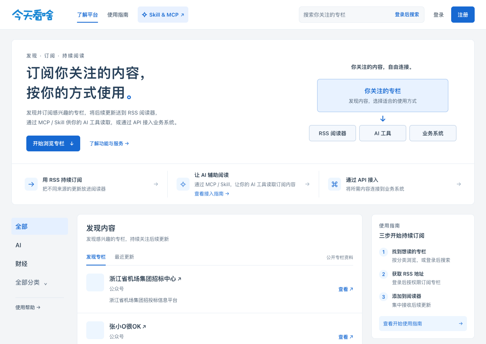

<!-- Generated documentation. Please submit content corrections through Issues. -->

# 微信公众号 RSS 订阅指南

使用今天看啥获取微信公众号 RSS 地址，把公众号文章接入自己的阅读器、程序和 AI 工具。

WeChat public account RSS guide: subscribe with Jintiankansha, then read feeds or integrate with APIs and MCP.

本仓库由 **TodayRSS Labs** 维护，提供 今天看啥 托管服务的使用指南和接入入口，公开内容包括文档与客户端示例。

**[开始查找微信公众号](https://www.jintiankansha.me/search)**（需要登录） · [注册账号](https://www.jintiankansha.me/account/signup) · [会员与使用条件](https://www.jintiankansha.me/help/membership)

## 支持什么，需要什么条件

| 接入方式 | 当前能力 | 使用条件 |
| --- | --- | --- |
| RSS | 可用 | 订阅后取得个人专属地址，受账号权益与访问额度限制 |
| API | 可用 | 按接口核对会员、积分或企业权益 |
| MCP | 可用：只读工具 | 使用独立 MCP 密钥，访问有权读取的已订阅内容 |

订阅和搜索需要登录今天看啥；RSS 订阅受账号数量与有效期限制。[会员说明](https://www.jintiankansha.me/help/membership)区分免费体验、付费会员、企业权益和积分。免费体验不保证文章更新。

稳定极速订阅、历史文章同步等是按条件开通的附加服务，不能理解为购买会员后全部自动获得。价格和配额请查看当前官网及开通页面。

## 订阅后是什么样

在阅读器中，已订阅公众号会成为独立来源，可以和博客等其他 RSS 来源放在同一个列表中阅读。今天看啥公开教程介绍了公众号全文 RSS 的取址方式。

图片是[今天看啥公开首页](https://www.jintiankansha.me)的实际页面参考，不含个人专属订阅地址，也不是登录后阅读器的效果截图。RSS 文章呈现受来源内容与阅读器支持影响，操作以当前界面为准。

## 完成第一次订阅

1. [注册](https://www.jintiankansha.me/account/signup)或[登录今天看啥](https://www.jintiankansha.me/account/signin)。
2. 在[搜索](https://www.jintiankansha.me/search)中输入公众号名称，打开并核对目标专栏。
3. 在专栏页面点击「RSS 订阅」，确认订阅状态。
4. 在专栏的「您的专属RSS链接」处复制完整地址，也可到[订阅管理](https://www.jintiankansha.me/subscribe/rss/subscribed)复制「RSS 订阅地址」。
5. 在阅读器中添加该地址，打开来源检查文章。

复制的是**个人专属 RSS 地址**，不是专栏网页或单篇文章网址。完成标志：阅读器中出现目标来源及平台已有文章。后续新内容取决于源账号发布、平台更新和阅读器拉取。

[完整订阅教程](docs/subscribe.md) · [添加阅读器与导入 OPML](https://github.com/todayrss-labs/.github/blob/main/docs/readers.md)

## 接入程序或 AI

**RSS**：订阅后，可以将自己的 RSS 地址交给支持 RSS 的程序或工作流读取。[最小 Python 示例](https://github.com/todayrss-labs/.github/blob/main/examples/read_feed.py)使用标准库解析 RSS / Atom，不需要 API 密钥。

**API**：[基础 API](https://www.jintiankansha.me/about/api/basic)用于获取账号订阅列表和所订阅专栏的原始文章链接。基础 API 按当前产品说明要求 VIP-1 及以上；[扩展 API](https://www.jintiankansha.me/about/api/more_api)可按条件获取文章正文，需核对开通和积分；[高级 API 与推送回调](https://www.jintiankansha.me/about/api/adv)按企业权益及调用文档接入。购买某种权益不代表所有 API 自动可用。

**MCP / Skill**：今天看啥已发布[智能体接入指南](http://mcp.jintiankansha.me/main/start)。使用独立的 **MCP 密钥**连接支持的客户端，可以列出订阅、查询有权访问的已订阅文章并读取正文；不是全网搜索或订阅写入工具。

在 [MCP 管理页](http://mcp.jintiankansha.me/account/mcp)配置接入后，以“列出我的订阅，再读取其中一篇文章”验证。访问受主站身份、[权限与额度](http://mcp.jintiankansha.me/main/limits)限制；API 密钥与 MCP 密钥不能混用。客户端自身费用按对应产品规则执行。

[接入方式、条件与验证步骤](docs/integrations.md)

## 示例与应用

**可运行示例**：[Python RSS / Atom 读取示例](https://github.com/todayrss-labs/.github/blob/main/examples/read_feed.py)。先使用配套离线 XML 验证解析，再换成自己的 RSS 地址。

**界面参考**：本指南截图取自公开产品页面与产品教程。真实 RSS 地址需要在自己的账号订阅后取得；这里不发布个人订阅地址。

- **公众号集中阅读**：公众号 RSS → 阅读器分类 → 集中查看文章。
- **程序处理文章**：个人 RSS 或有权使用的 API → 程序解析 → 自己的检索或摘要流程。
- **AI 阅读订阅**：今天看啥 MCP → 查询已订阅文章 → 读取正文并总结。使用范围见接入权限说明。

## 常见问题

- **是否收费？** 先查看[会员与购买](https://www.jintiankansha.me/help/membership)，会员权益和按需开通的附加服务分别核对。
- **找不到来源？** 查看[完整教程中的收录流程](docs/subscribe.md#找不到来源时)。提交成功与收录成功是不同状态。
- **添加失败或没有更新？** 查看[问题排查](docs/faq.md#添加失败或没有更新)。

[全部常见问题](docs/faq.md) · [产品支持](https://www.jintiankansha.me/about#contact) · [反馈文档问题](https://github.com/todayrss-labs/wechat-rss-guide/issues)

## 来源与核对日期

文档事实核对日期：**2026-10-23**。操作入口、支持条件和权益以对应产品的当前说明为准。

- [今天看啥开始使用](https://www.jintiankansha.me/help/start)
- [微信公众号订阅教程](https://www.jintiankansha.me/about/weixin/rss_gonglue)
- [今天看啥会员与购买](https://www.jintiankansha.me/help/membership)
- [今天看啥基础 API 说明](https://www.jintiankansha.me/about/api/basic)

更多来源：[TodayRSS Labs](https://github.com/todayrss-labs) · [微信公众号 RSS](https://github.com/todayrss-labs/wechat-rss-guide) · [X / Twitter RSS](https://github.com/todayrss-labs/x-rss-guide)
