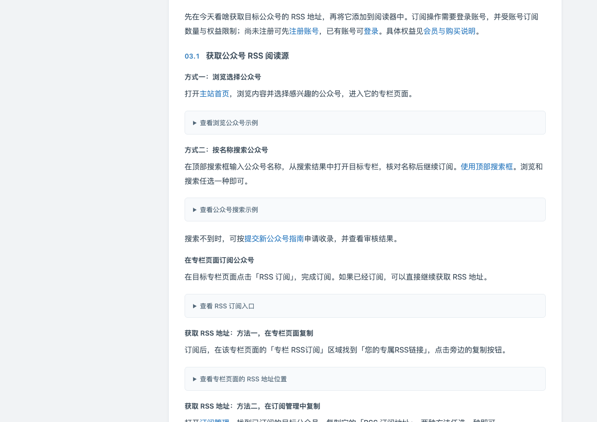
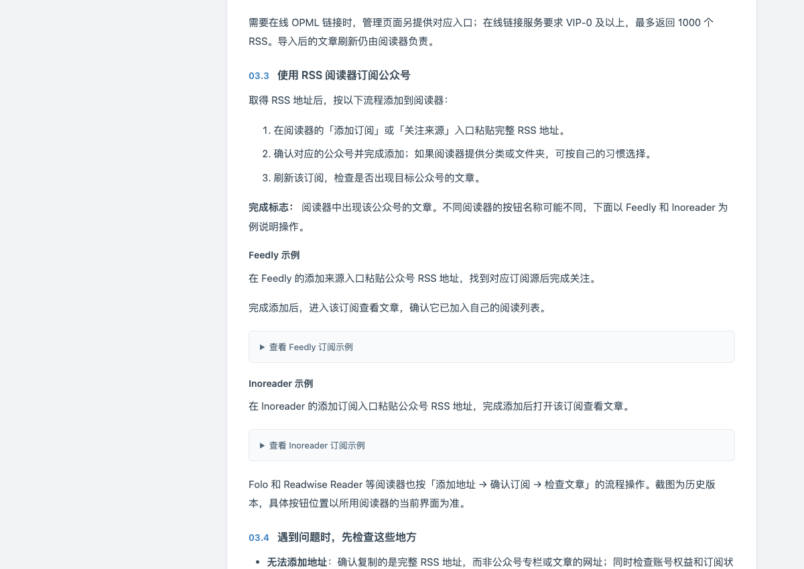

<!-- Generated documentation. Please submit content corrections through Issues. -->

# 使用 今天看啥 订阅微信公众号

本文从查找来源开始，完成订阅、获取 RSS 地址并添加阅读器。需要 今天看啥 账号和支持添加 RSS 地址的阅读器。

## 开始前确认

订阅和搜索需要登录今天看啥；RSS 订阅受账号数量与有效期限制。[会员说明](https://www.jintiankansha.me/help/membership)区分免费体验、付费会员、企业权益和积分。免费体验不保证文章更新。

稳定极速订阅、历史文章同步等是按条件开通的附加服务，不能理解为购买会员后全部自动获得。价格和配额请查看当前官网及开通页面。

## 已收录来源的订阅步骤

1. [注册](https://www.jintiankansha.me/account/signup)或[登录今天看啥](https://www.jintiankansha.me/account/signin)。
2. 在[搜索](https://www.jintiankansha.me/search)中输入公众号名称，打开并核对目标专栏。
3. 在专栏页面点击「RSS 订阅」，确认订阅状态。
4. 在专栏的「您的专属RSS链接」处复制完整地址，也可到[订阅管理](https://www.jintiankansha.me/subscribe/rss/subscribed)复制「RSS 订阅地址」。
5. 在阅读器中添加该地址，打开来源检查文章。

## 获取 RSS 地址与批量管理

订阅后有两种取址方式，任选一种：

- 在公众号专栏页面的「专栏 RSS订阅」区域，复制「您的专属RSS链接」。
- 在[订阅管理](https://www.jintiankansha.me/subscribe/rss/subscribed)找到对应公众号，复制「RSS 订阅地址」。

图片为[产品公开教程](https://www.jintiankansha.me/about/weixin/rss_gonglue)参考，不是个人登录后的取址实拍。请复制自己账号中的地址。

多个订阅可从 [OPML 管理](https://www.jintiankansha.me/subscribe/rss/mgr)导出订阅列表，再到阅读器导入。在线 OPML 链接和文件导出不是同一功能；在线链接的会员与条数条件见官网教程。

## 找不到来源时

先搜索确认尚未收录，再打开[提交公众号](https://www.jintiankansha.me/account/rss/submit)。准备公众号名称和一条包含 `mp.weixin.qq.com` 的文章原链接，按需要勾选审核通过后自动订阅。

提交后到[提交记录](https://www.jintiankansha.me/account/rss/submit/list)检查状态。提交成功不等于已经收录，勾选自动订阅也要等审核通过；未勾选时，通过后再手动订阅。

会员提交条件、月度额度和审核说明见[今天看啥提交指南](https://www.jintiankansha.me/about/weixin/submit)。增加提交额度不保证审核通过。

## 添加到阅读器并确认结果

在阅读器的添加来源入口粘贴完整 RSS 地址，确认来源后完成添加。打开该来源，检查是否出现目标来源及已有文章。阅读器界面操作见[公共阅读器教程](https://github.com/todayrss-labs/.github/blob/main/docs/readers.md)。

如果没有可显示的已有文章，先核对专栏内容和订阅状态；后续更新还依赖源账号发布、平台更新和阅读器刷新。

图片来源：[今天看啥 订阅教程](https://www.jintiankansha.me/about/weixin/rss_gonglue)，用于定位说明；不是本次登录账号完成订阅后的实拍。

[排查问题](faq.md#添加失败或没有更新) · [返回指南](../README.md)

事实核对日期：2026-10-23。
